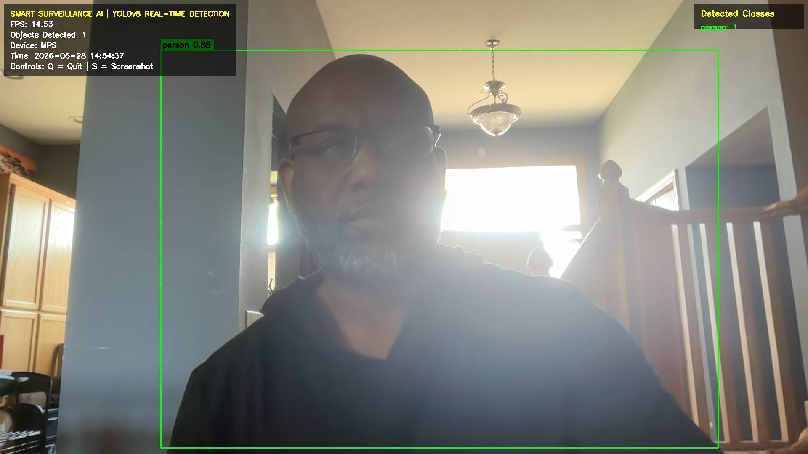

> **Applied AI portfolio project by Brent Oatis, MBA**
> Deploying real-time object detection for edge inspection, safety, and operational visibility.

# Smart Surveillance AI

Real-Time Object Detection using YOLOv8



**Course:** CST 544 – Artificial Intelligence in Computer Vision  
**Assignment:** Week 7 – Real-Time Computer Vision Application  
**Student:** Brent Oatis  
**University:** Concordia University, St. Paul  
**Date:** June 2026

---

# Project Overview

Smart Surveillance AI is a real-time computer vision application developed using the YOLOv8 object detection model and OpenCV. The application processes live webcam or video input, detects multiple object classes in real time, and overlays bounding boxes, confidence scores, object counts, and performance metrics while maintaining smooth execution on standard hardware.

The project demonstrates practical deployment of a modern computer vision model in a local production environment while exploring topics including deployment strategies, scalability, performance optimization, and ethical considerations associated with AI-powered surveillance systems.

---

# Project Objectives

- Deploy a pre-trained YOLOv8 object detection model locally
- Perform real-time object detection on live video
- Display bounding boxes and confidence scores
- Monitor application performance using Frames Per Second (FPS)
- Record annotated video output
- Capture screenshots during execution
- Demonstrate scalable computer vision deployment

---

# Features

- Real-Time Object Detection
- YOLOv8 Nano Model
- Apple Silicon (MPS) Acceleration
- Webcam or Video File Support
- Automatic Bounding Boxes
- Confidence Scores
- Object Class Labels
- Live FPS Monitoring
- Smart Surveillance Dashboard
- Object Counter
- Screenshot Capture
- Video Recording
- Timestamped Output

---

# Technologies Used

| Technology | Purpose |
|------------|---------|
| Python | Application Development |
| YOLOv8 | Object Detection |
| Ultralytics | YOLO Framework |
| OpenCV | Video Processing |
| PyTorch | Deep Learning Framework |
| Apple Metal (MPS) | GPU Acceleration |

---

# Project Structure

```text
Week7_RealTimeYOLOObjectDetection/

│
├── assets/
│   ├── output/
│   ├── screenshots/
│   └── demo_video.mp4
│
├── yolo_realtime_detector.py
├── requirements.txt
├── README.md
├── .gitignore
└── LICENSE
```

---

# Installation

Clone the repository.

```bash
git clone <repository-url>
```

Navigate into the project.

```bash
cd Week7_RealTimeYOLOObjectDetection
```

Create a virtual environment.

```bash
python3 -m venv .venv
```

Activate the virtual environment.

macOS

```bash
source .venv/bin/activate
```

Windows

```powershell
.venv\Scripts\activate
```

Install dependencies.

```bash
pip install -r requirements.txt
```

---

# Running the Application

Launch the webcam.

```bash
python yolo_realtime_detector.py --source 0
```

Launch with recording enabled.

```bash
python yolo_realtime_detector.py --source 0 --save
```

Run against a video file.

```bash
python yolo_realtime_detector.py --source path/to/video.mp4
```

---

# Controls

| Key | Action |
|-----|--------|
| **Q** | Quit Application |
| **S** | Save Screenshot |

---

# Output

### Video Recordings

```
assets/output/
```

### Screenshots

```
assets/screenshots/
```

---

# Sample Objects Detected

During testing, the application successfully detected:

- Person
- Backpack
- Banana
- Chair
- Laptop
- Cell Phone
- Book
- Cup
- Bottle

Additional object classes supported depend on the YOLOv8 COCO dataset.

---

# Scaling Strategies

Several approaches improve scalability for production deployment:

- Edge inference for low latency
- Hybrid cloud-edge deployment
- GPU acceleration
- Model quantization
- Load balancing
- Distributed computing
- Batch processing
- Continuous model monitoring

---

# Ethical Considerations

Although computer vision offers significant operational advantages, developers must deploy these systems responsibly.

Important ethical considerations include:

- Bias in facial and object recognition
- Privacy protection
- Responsible surveillance practices
- Transparency
- Explainable AI
- Human oversight
- Accountability
- Secure data management

Responsible deployment requires continuous monitoring, fairness evaluations, and compliance with applicable legal and ethical standards.

---

# Challenges Encountered

- Configuring the local Python environment
- Optimizing inference for Apple Silicon
- Managing real-time video performance
- Balancing confidence thresholds and detection accuracy
- Maintaining smooth FPS during live detection

---

# Lessons Learned

This project demonstrated that deploying an AI model extends beyond simply training it. Successful production deployment requires thoughtful consideration of hardware, scalability, latency, monitoring, and ethical governance. Real-time object detection systems must continuously balance speed, accuracy, and operational reliability while maintaining public trust.

---

# Future Enhancements

Potential future improvements include:

- Face recognition integration
- License plate recognition
- Person tracking
- Intrusion detection
- Email or SMS alerts
- Cloud deployment
- REST API integration
- Database logging
- Object tracking across frames
- Industrial quality inspection

---

# Model

YOLOv8 Nano

https://github.com/ultralytics/ultralytics

---

# Dataset

COCO (Common Objects in Context)

https://cocodataset.org/

---

# References

GeeksforGeeks. (2024). *What is object detection in computer vision?* https://www.geeksforgeeks.org/what-is-object-detection-in-computer-vision/

Jocher, G., Chaurasia, A., & Qiu, J. (2024). *Ultralytics YOLO Documentation.* https://docs.ultralytics.com/

Ponnusamy, A. (2018). *YOLO object detection with OpenCV and Python.* Medium. https://medium.com/towards-data-science/yolo-object-detection-with-opencv-and-python-21e50ac599e9

Redmon, J., Divvala, S., Girshick, R., & Farhadi, A. (2016). *You Only Look Once: Unified, real-time object detection.* Proceedings of the IEEE Conference on Computer Vision and Pattern Recognition, 779–788.

Ultralytics. (2024). *YOLOv8 Documentation.* https://docs.ultralytics.com/

---

# Author

**Brent Oatis**

MBA Candidate | AI & Computer Vision | Manufacturing & Operations Leadership

*"Bringing together artificial intelligence, manufacturing excellence, and operational leadership to build intelligent systems that solve real-world problems."*
